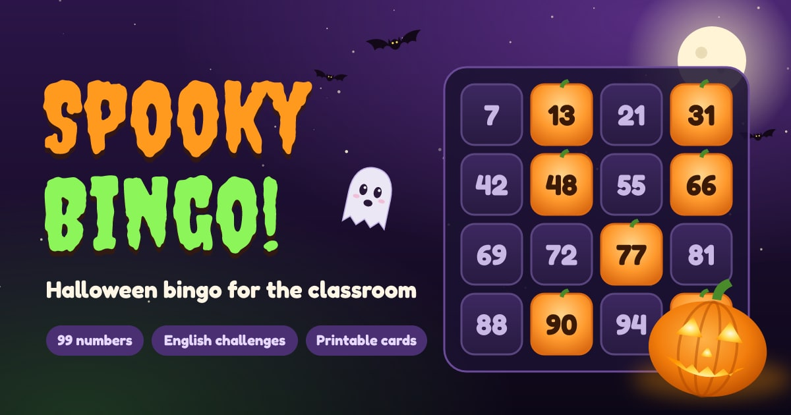

# Spooky Bingo

A Halloween-themed bingo (tombola) board for the classroom, made for children aged 7–10. The teacher runs it on a big widescreen display and the class plays along with printed cards. Between draws, the host can launch short English-language challenges.

**Play it:** [moebiusmania.github.io/bingo-school](https://moebiusmania.github.io/bingo-school/)

## Features

- **Animated draws.** The numbers 1–99 are drawn from a bubbling cauldron, revealed with a spooky voice, and fly onto the board, where they turn into pumpkins. Draws use `crypto.getRandomValues`, so they are fair.
- **Sound without audio files.** Every effect is synthesized live with the Web Audio API. The Web Speech API reads each number aloud.
- **Keyboard friendly.** Press Space or Enter to draw the next number, or to skip the reveal.
- **English challenges.** There are 5 levels, from "Double Boo" to "Bingo!", with 5 short exercises each: spelling, plurals, opposites, verbs and more. The host marks each answer **Correct** or **Wrong**, and the board celebrates or groans.
- **Printable cards.** 24 unique tombola cards fit 3 to an A4 sheet, ready to cut. Every number appears on 3–4 cards. The layout is seeded, so a printed set can always be reproduced.
- **Answers page for the host.** It lists every challenge with its answer and works on a phone.
- **Remembers the game.** The game state and settings are saved in the browser, so a page reload doesn't lose the game.

## Pages

| Page | URL | Who it's for |
| --- | --- | --- |
| Board | [`/bingo-school/`](https://moebiusmania.github.io/bingo-school/) | The class, on a widescreen display (1150 px wide or more) |
| Cards | [`/bingo-school/cards`](https://moebiusmania.github.io/bingo-school/cards/) | Print, cut and hand out. Add `?seed=123` for a different set |
| Answers | [`/bingo-school/answers`](https://moebiusmania.github.io/bingo-school/answers/) | The host only, on any device |

## Scope

Spooky Bingo is built for one teacher running one game on one desktop screen. Phone and tablet layouts are out of scope for the board and the cards. The answers page is the exception and also works on a phone. There are no accounts, no server and no network play. Everything runs in the browser and is hosted as a static site on GitHub Pages.

## Stack

- [Deno](https://deno.com/) 2 as the runtime and task runner. npm packages come in through `deno.json`, and there is no `package.json`.
- [Vite](https://vite.dev/) for the multi-page build (board, cards and answers).
- [Preact](https://preactjs.com/) 11 and TypeScript.
- CSS Modules. The layout uses container query units, so the board scales to fill the screen.
- Canvas 2D for the night sky, the bats and the particle effects. The artwork is hand-made inline SVG.
- Web Audio API and Web Speech API.
- [Creepster](https://fonts.google.com/specimen/Creepster) and [Fredoka](https://fonts.google.com/specimen/Fredoka) fonts, from Fontsource.

## Run it locally

You need [Deno 2](https://docs.deno.com/runtime/getting_started/installation/). Deno installs the dependencies on the first run.

```sh
git clone git@github.com:moebiusmania/bingo-school.git
cd bingo-school
deno task dev
```

Then open <http://localhost:5173/bingo-school/>. The dev server is also reachable from other devices on your network, which is handy for checking the answers page on a phone.

| Command | What it does |
| --- | --- |
| `deno task dev` | Start the dev server with hot reload |
| `deno task check` | Type-check the project |
| `deno task build` | Build the static site into `dist/` |
| `deno task preview` | Serve the built `dist/` locally |

### Changing the challenges

All challenge content lives in [`src/game/challenges.json`](src/game/challenges.json). There are 5 levels with 5 challenges each, and every challenge has a `title`, a `prompt` and an `answer`. In a prompt, `\n` starts a new line. The board and the answers page both read this file, so there is nothing else to update.

### Deployment

Every push to `main` runs [`.github/workflows/deploy.yml`](.github/workflows/deploy.yml). It type-checks, builds and publishes `dist/` to GitHub Pages. The site is served from `/bingo-school/`, the `base` set in `vite.config.ts`.

## Contributing

Contributions are welcome, especially new challenges. Read [CONTRIBUTING.md](CONTRIBUTING.md) for how to set up the project, the conventions to follow and how to open a pull request.

## License

[MIT](LICENSE) © 2026 Salvatore Laisa
